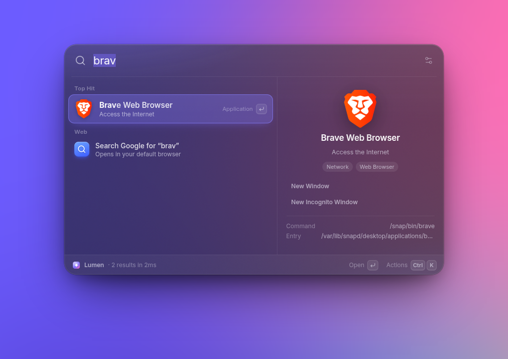
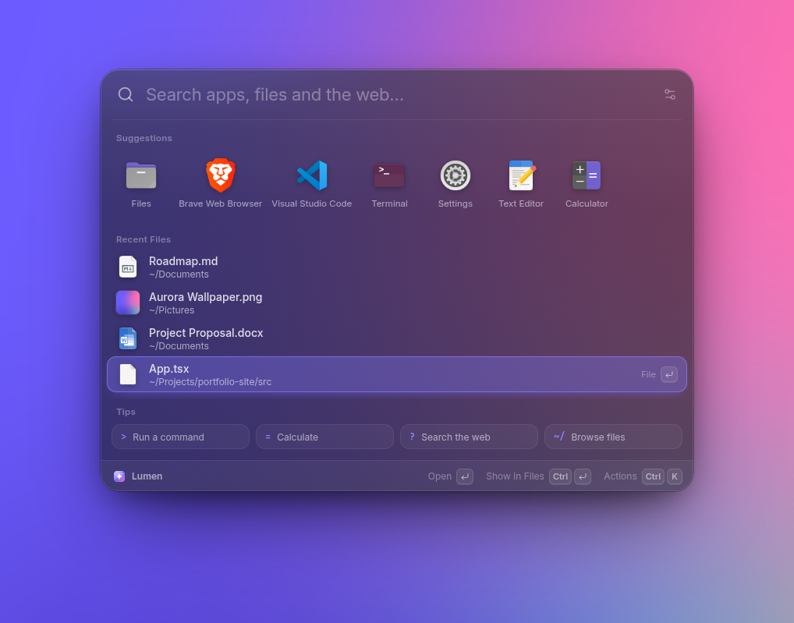
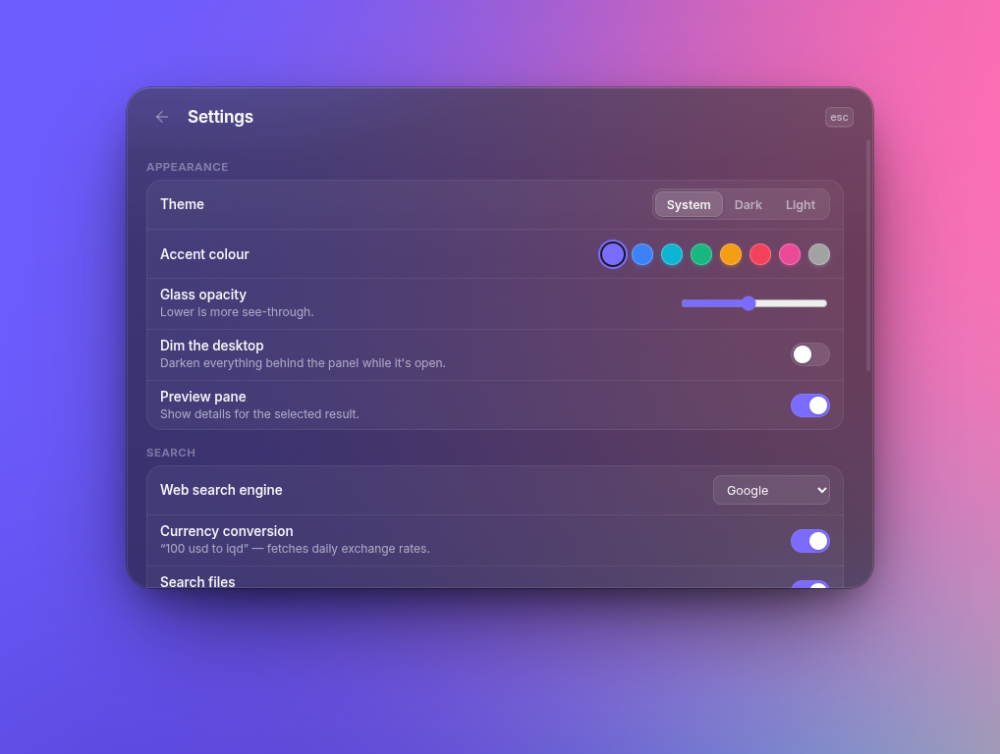
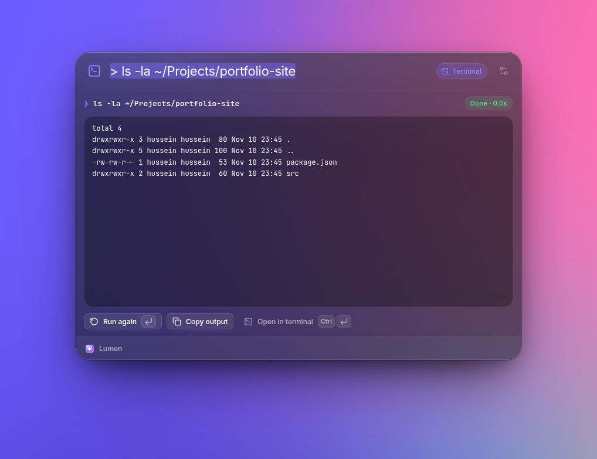
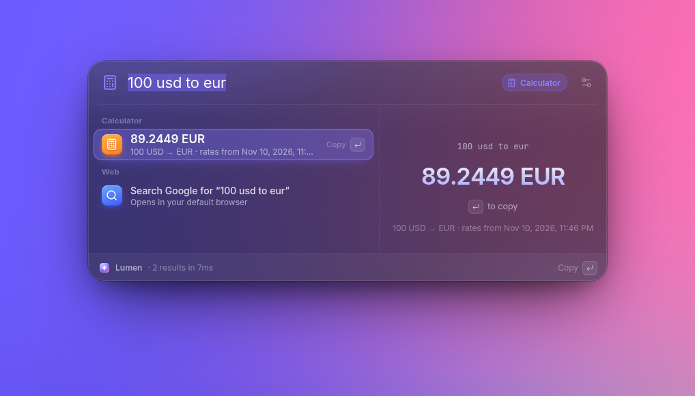
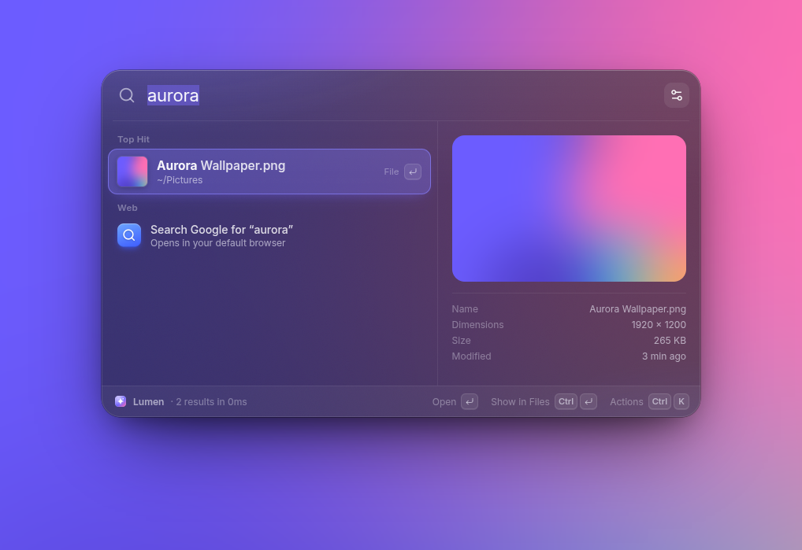
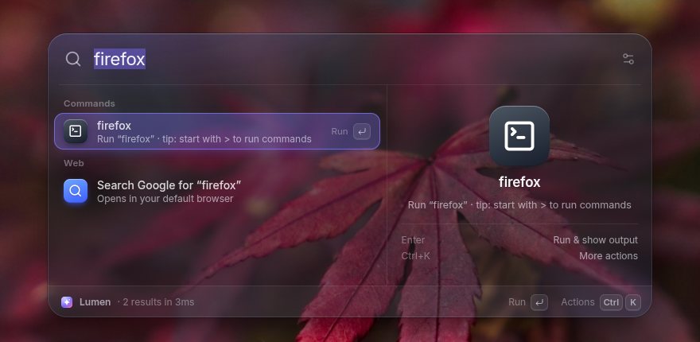
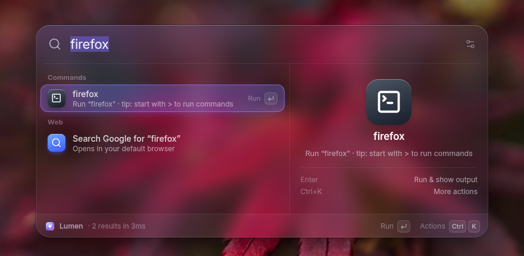
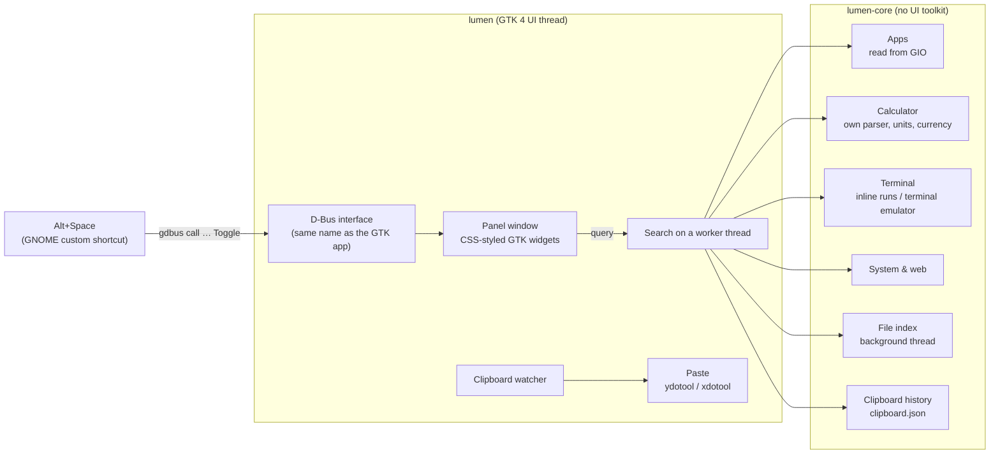

<div align="center">


# Lumen

**A fast, glassy, Spotlight-style launcher for Linux.**
Press <kbd>Alt</kbd> + <kbd>Space</kbd> to find apps, files and folders, run terminal commands, do math and conversions, paste from your clipboard history, and open or search the web, all from one panel.

[](https://github.com/smith8h/lumen/actions/workflows/release.yml)
[](https://github.com/smith8h/lumen/releases/latest)


[](LICENSE)



</div>

## Features

- **Apps.** Every installed app (system, Flatpak, Snap, `~/.local`), with the icons from your icon theme and each app's quick actions like *New Incognito Window*.
- **Files and folders.** An in-memory index on a background thread answers in a few milliseconds, with fuzzy matching (`projprop` or `ppd` → *Project Proposal.docx*), recently used files ranked higher, and live previews of images, text, code and folders.
- **Path browsing.** Type `~/` or `/` to walk the filesystem directly.
- **Terminal.** `> htop` opens in your terminal; `> ls -la` runs right in the panel and streams the output. Ctrl+Enter sends any command to a real terminal.
- **Calculator.** `2^10`, `sqrt(2) * pi`, `15% of 80`, unit conversion (`5 km to mi`, `30 c to f`, `5 GB to MB`) and currency (`100 usd to iqd`).
- **Web.** URLs open directly in your default browser (Brave, Firefox, Chrome…). Anything else can be searched, with shortcuts like `yt`, `gh`, `wiki`, `maps`, `npm`, `so` and `tr`.
- **Clipboard history.** Type `;` to see the text you copied in any app, search it, and press Enter to paste it straight into the app you were using. Pin the clips you reuse. [More below](#clipboard-history).
- **System.** Lock, sleep, log out, restart, shut down, dark/light mode, Wi-Fi, Do Not Disturb, empty Trash. Destructive actions ask for a second Enter.
- **Learns from you.** Frecency ranking puts what you open most at the top, and the start screen shows your favourite apps and recent files.
- **Feels native.** Glass design with a light/dark theme, accent colours, smooth spring animations, a sliding selection, full keyboard control and an actions menu (Ctrl+K).
- **Real glass on GNOME.** An optional GNOME Shell extension blurs whatever is behind the panel, like macOS, and keeps Lumen out of the dock and Alt+Tab.
- **Instant toggle.** The shortcut talks to the running app over D-Bus, so the panel appears in about 5 ms.

## Screenshots

| | |
|:-:|:-:|
|  |  |
| **Start screen:** favourite apps, recent files, tips | **Files:** fuzzy search with live preview |
|  |  |
| **Terminal:** run commands and see the output | **Calculator:** math, units and currency |
|  |  |
| **Image previews** | **Settings:** theme, accent, glass, search engine |

## Install

Lumen is a native GTK 4 app written in Rust. It needs GTK 4.14 or newer (Ubuntu 24.04, Fedora 40, Debian 13 and later). Download the latest **.deb** or **tarball** from [Releases](https://github.com/smith8h/lumen/releases/latest).

**Any distro** (no root needed):

```bash
tar xzf lumen-*-x86_64-linux.tar.gz
./lumen-*-x86_64-linux/install.sh    # → ~/.local/bin/lumen plus a menu entry
lumen
```

**From source** (needs Rust and `libgtk-4-dev` / `gtk4-devel`):

```bash
scripts/install.sh                   # builds and installs to ~/.local
scripts/install.sh --uninstall
```

On first launch Lumen adds itself to *Startup Applications* and offers to set up <kbd>Alt</kbd>+<kbd>Space</kbd>.

**Debian / Ubuntu:**

```bash
sudo apt install ./lumen_*_amd64.deb
```

Then open **Lumen** from your app menu.

### The shortcut

On **GNOME** (Ubuntu, Fedora, …) Lumen sets up <kbd>Alt</kbd>+<kbd>Space</kbd> for you with one click. It adds a custom shortcut, the same thing *Settings → Keyboard → Custom Shortcuts* does, and moves GNOME's own Alt+Space window menu out of the way. Undo it anytime in Settings, or from a terminal:

```bash
lumen --setup-shortcut
lumen --remove-shortcut    # restores GNOME's original Alt+Space
```

On **other desktops** (KDE Plasma, Cinnamon, Xfce, Hyprland, Sway…), bind <kbd>Alt</kbd>+<kbd>Space</kbd> to `lumen --toggle` in the desktop's keyboard settings. The welcome screen shows the exact command.

### GNOME extension for real blur (optional)

GNOME doesn't let regular apps blur what's behind their windows, so on its own Lumen's glass is a frosted tint. The **Lumen Glass** GNOME Shell extension adds the rest from inside the compositor:

- **Real background blur** under the panel, clipped to its rounded corners and following its size as results change. Lumen notices the extension and makes its own tint more see-through.
- **No dock or Alt+Tab entry** while the panel is open.
- **Reliable focus**, so you can type the moment the panel appears.
- **Smarter clipboard history**: it skips passwords that password managers mark as secret, and pastes with Ctrl+Shift+V when you came from a terminal.

| Without the extension | With the extension |
|:-:|:-:|
|  |  |

<sub>Wallpaper: *Red Acer* by mendhak, from Ubuntu's wallpaper set.</sub>

It needs GNOME Shell 50. Lumen works the same without it.

1. Download `lumen@lumenlauncher.github.io.shell-extension.zip` from [Releases](https://github.com/smith8h/lumen/releases/latest), or build it with `scripts/pack-extension.sh`.
2. Install it:
   ```bash
   gnome-extensions install --force lumen@lumenlauncher.github.io.shell-extension.zip
   ```
3. **Log out and back in.** On Wayland, GNOME only loads new extensions at login.
4. Turn it on:
   ```bash
   gnome-extensions enable lumen@lumenlauncher.github.io
   ```
   or use the *Extensions* app.

To remove it: `gnome-extensions uninstall lumen@lumenlauncher.github.io`.

## Clipboard history

Lumen remembers text you copy in any app. Type `;` to see it, pinned clips first, then newest. Keep typing to search it.

| Keys | What it does |
| --- | --- |
| <kbd>Enter</kbd> | Paste into the app you were using before Lumen opened |
| <kbd>Ctrl</kbd>+<kbd>Enter</kbd> | Copy only, without pasting |
| <kbd>Ctrl</kbd>+<kbd>Shift</kbd>+<kbd>P</kbd> | Pin or unpin. Pinned clips are never dropped |
| <kbd>Ctrl</kbd>+<kbd>D</kbd> | Delete the clip |
| <kbd>Ctrl</kbd>+<kbd>K</kbd> | All actions, including *Paste into terminal* (Ctrl+Shift+V) |

To clear everything except pinned clips, search for **Clear Clipboard History**, or use *Settings → Clipboard*. There you can also pause recording, turn history off, keep it in memory only, and choose how many clips to keep (200 by default).

**Privacy.** Clips never leave your computer. They're saved in `~/.config/Lumen/clipboard.json`, readable only by you, and never written to logs. Clips only show up after you type `;`, never in normal searches. Copies over 100 KB are skipped. With the [GNOME extension](#gnome-extension-for-real-blur-optional), copies that password managers such as KeePassXC or Bitwarden mark as secret are skipped too. History is text only for now.

**Automatic paste.** To press Ctrl+V in another app for you, Lumen uses [`ydotool`](https://github.com/ReimuNotMoe/ydotool) on Wayland, or `xdotool` on X11. On Ubuntu:

```bash
sudo apt install ydotool
systemctl --user enable --now ydotool   # starts the ydotoold service
```

`ydotoold` needs access to `/dev/uinput`. If the service doesn't start, see ydotool's README. Without ydotool, Enter still copies the clip and Lumen tells you to press Ctrl+V. With the GNOME extension, Lumen also knows when you came from a terminal and pastes with Ctrl+Shift+V there.

## Using Lumen

| Keys | What it does |
| --- | --- |
| <kbd>Alt</kbd>+<kbd>Space</kbd> | Open or close Lumen |
| <kbd>↑</kbd> <kbd>↓</kbd> · <kbd>Ctrl</kbd>+<kbd>N</kbd>/<kbd>P</kbd> | Move through results |
| <kbd>Enter</kbd> | Open, run or copy the selected result |
| <kbd>Ctrl</kbd>+<kbd>Enter</kbd> | Show a file in Files · run a command in the terminal |
| <kbd>Ctrl</kbd>+<kbd>K</kbd> or <kbd>Tab</kbd> | More actions (copy path, open terminal here, app actions…) |
| <kbd>Ctrl</kbd>+<kbd>,</kbd> | Settings |
| <kbd>Esc</kbd> | Clear the search, then close |
| Click outside | Close |

| Type | To |
| --- | --- |
| `> command` | Run a shell command (inline output, or in your terminal) |
| `= expression` | Force calculator mode |
| `? query` | Search the web |
| `;` or `; text` | Clipboard history: browse or search, Enter pastes |
| `~/` or `/` | Browse folders |
| `yt` `gh` `wiki` `maps` `npm` `so` `tr` `img` `reddit` `mdn` + text | Search that site |
| `github.com`, `localhost:3000`, `192.168.1.1` | Open in your browser |

## How it works



The code is split in two crates. `lumen-core` holds everything that isn't UI: ranking, the fuzzy matcher, the calculator, clipboard history, the file index, settings and the GNOME shortcut setup. It has no GTK dependency and is covered by `cargo test`. `lumen` is the GTK 4 app around it.

A few details worth knowing:

- **Wayland first.** Wayland doesn't let apps place their own windows or grab global keys. Lumen opens a transparent, maximized window and draws the panel at Spotlight's position itself, so placement is the same on every compositor. A click on the transparent area, or focus moving elsewhere, closes it.
- **The shortcut is instant.** Lumen's D-Bus interface lives on the same bus name as its GTK application, and GNOME runs `gdbus call … Toggle` straight into the running process. A second `lumen --toggle` also works: GTK forwards it to the running instance and exits.
- **Real blur from the compositor.** Lumen broadcasts the panel's rectangle as the D-Bus signal `PanelGeometry(x, y, w, h, radius)` on every size change, including animations. The GNOME extension finds Lumen's window by the PID that owns the bus name and puts an actor under it. That actor copies the pixels behind the panel, blurs them on the GPU (Clutter paint nodes: blit, downscale, gaussian) and draws them through a small GLSL shader that clips to the rounded rectangle and adds saturation. The extension sets Lumen's `ShellBlur` D-Bus property so the panel can lower its own tint.
- **The look is CSS.** The "Lit glass" design tokens are computed in Rust for the current theme and accent (GTK 4.14 has no CSS variables or `color-mix()`) and filled into `crates/lumen/resources/style.css`. Icons are Lucide's line icons, drawn as GSK paths in the current text colour. Custom widgets handle the sliding selection light and the panel's animated height.
- **Clipboard history.** Lumen watches the clipboard (its change signal plus a light 0.7 s check), only while history is on and not paused. GNOME only sends clipboard changes to apps that have shown a window, so after a `--hidden` start at login Lumen shows its panel for 0.3 s at 1% opacity. To paste, Lumen puts the text on the clipboard while it still has focus, hides the panel, waits about 240 ms for focus to return, then presses Ctrl+V. The text never appears on a command line and is never logged.
- **Clean child processes.** Apps start through GIO with an activation token, so they get focus on Wayland and D-Bus activation and startup notification work. Commands and terminals start in their own session, and Lumen removes the variables that describe how *it* was started first.
- **Light on memory.** Lumen idles at about 40 MB. While the panel is drawn, its own memory is around 45 MB on top of the shared GPU driver libraries. After a minute hidden it destroys the panel's widgets; rebuilding them takes about a millisecond. Turn that off in Settings if you'd rather keep everything warm.

## Development

Requirements: Rust 1.92+, GTK 4.14+ development files (`sudo apt install libgtk-4-dev` on Ubuntu/Debian, `sudo dnf install gtk4-devel` on Fedora) and a Linux desktop.

```bash
cargo run                      # debug build (press Alt+Space or run `cargo run -- --toggle` again)
cargo test --workspace         # unit tests (core: calculator, fuzzy, clipboard history, files, settings…)
cargo clippy --workspace --all-targets -- -D warnings
cargo fmt --all
cargo deb -p lumen             # target/debian/lumen_x.y.z_amd64.deb (cargo install cargo-deb)
scripts/install.sh             # release build installed to ~/.local
scripts/make-icons.sh          # re-render packaging/icons from resources/icon.svg (needs rsvg-convert)

scripts/pack-extension.sh            # release/lumen@lumenlauncher.github.io.shell-extension.zip (extensions.gnome.org-ready)
scripts/pack-extension.sh --install  # pack + install for your user (log out and back in to load it)
scripts/extension-nested.sh          # nested GNOME Shell with the extension, running Lumen inside it
```

**Working on the extension without logging out.** `scripts/extension-nested.sh` starts a nested GNOME Shell in a window (`gnome-shell --devkit`, which needs `mutter-dev-bin` on Ubuntu) with only the Lumen extension enabled, then runs the debug build of Lumen inside it. It uses its own D-Bus session, settings and Lumen profile, so your real session is untouched. Add `--headless` to run it without a window. Debug builds can be driven over D-Bus there: `Show(query)`, `Key("ctrl+K")` and `Capture("/tmp/panel.png")` for screenshots. GNOME Shell can't reload extension code, so restart it after changing `gnome-extension/`.

Environment switches for testing:

| Variable | Effect |
| --- | --- |
| `LUMEN_DEBUG=1` | Keeps the panel open when it loses focus |
| `LUMEN_DEBUG_CSS=1` | Prints stylesheet parsing errors |
| `LUMEN_DEBUG_CLIPBOARD=1` | Traces clipboard reads (sizes only, never the text) |
| `LUMEN_USER_DATA=/tmp/x` | Uses a separate settings/history folder |
| `LUMEN_UNLOAD_MS=5000` | Destroys the hidden panel after this many ms instead of a minute |

Project layout:

```
crates/
  lumen-core/        search, ranking and storage, no UI toolkit (unit-tested)
    src/apps.rs        app ranking, results, Exec parsing
    src/calculator.rs  expression parser, units (units.rs), currency (rates.rs)
    src/files.rs       file index, path browsing, recent files, previews
    src/cliphistory.rs clipboard history logic (dedupe, pins, ranking)
    src/shortcut.rs    GNOME keybinding setup
    src/lib.rs         Core: shared state and the search orchestrator
  lumen/             the GTK 4 app
    src/app.rs         controller: show/hide, actions, settings, theme
    src/ui/            panel, results, preview, settings, welcome, output, custom widgets
    src/desktop.rs     apps and launching through GIO
    src/clipboard.rs   clipboard capture; paste.rs pastes into the previous app
    src/dbus.rs        D-Bus interface for the shortcut and the GNOME extension
    resources/style.css  the "Lit glass" stylesheet
gnome-extension/     optional GNOME Shell extension: real blur, dock/Alt+Tab hiding, focus, clipboard helpers
packaging/           .desktop file and icons
scripts/             install, extension packing, nested GNOME Shell
```

Settings live in `~/.config/Lumen/settings.json`. Usage history (for ranking) is in `history.json` next to it, and clipboard history is in `clipboard.json`.

## Releasing

Releases are built by GitHub Actions only when you **publish a GitHub release**, not on every push:

1. Push your changes to `main`.
2. On GitHub, go to **Releases → Draft a new release**, create a tag like `v0.2.0`, and publish it.
3. The [Release workflow](.github/workflows/release.yml) sets the app version from the tag, runs the tests, builds on Ubuntu 24.04 (the oldest supported GTK), and attaches the `.deb`, a tarball, the GNOME extension zip and `SHA256SUMS.txt` to that release.

To rebuild an existing release, run the workflow by hand from the **Actions** tab and enter the tag.

## Known limitations

- GNOME doesn't give apps real background blur, so without the [GNOME extension](#gnome-extension-for-real-blur-optional) the glass is a frosted tint. Other desktops get the tint only.
- On Wayland without the extension, Lumen's window shows up in the dock and Alt+Tab while the panel is open.
- Automatic shortcut setup covers GNOME. Other desktops need the one-time manual binding above.
- Pasting a clip automatically needs `ydotool` on Wayland ([setup](#clipboard-history)). Without it, you press Ctrl+V yourself. Clipboard history is text only for now.

## Roadmap

- Emoji picker; images in clipboard history
- Plugin API for custom providers
- Flatpak, AppImage and AUR packages

## License

[MIT](LICENSE) © 2026 Hussein Shakir
