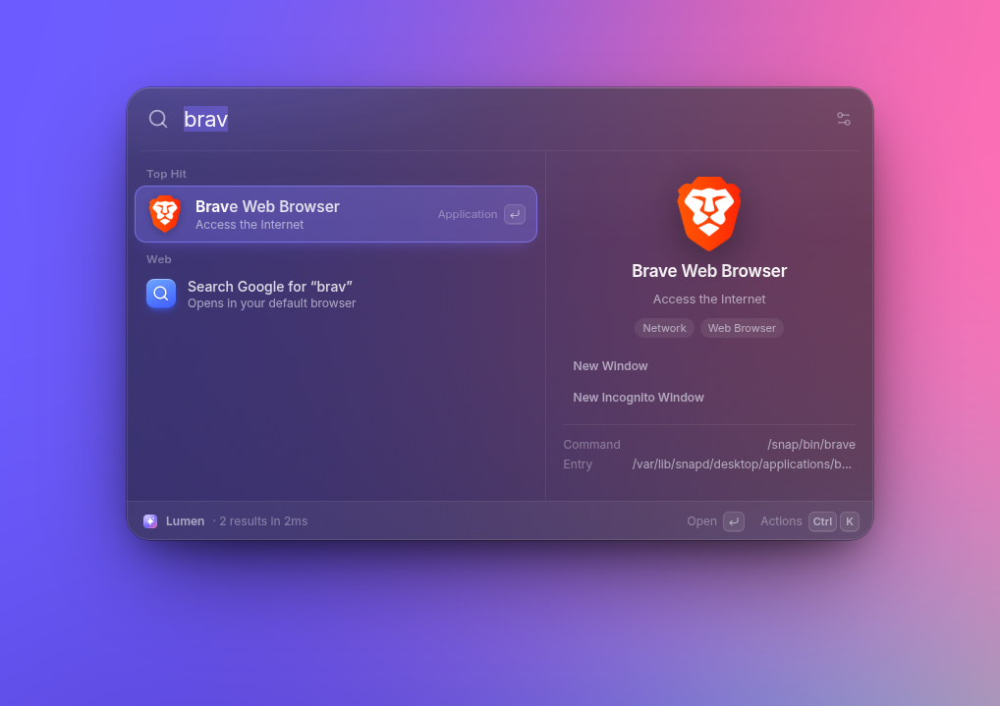
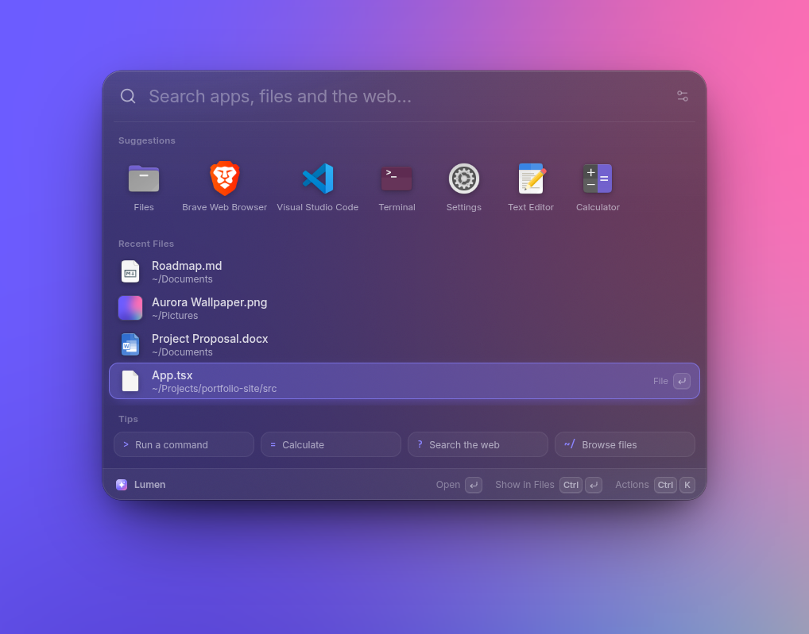
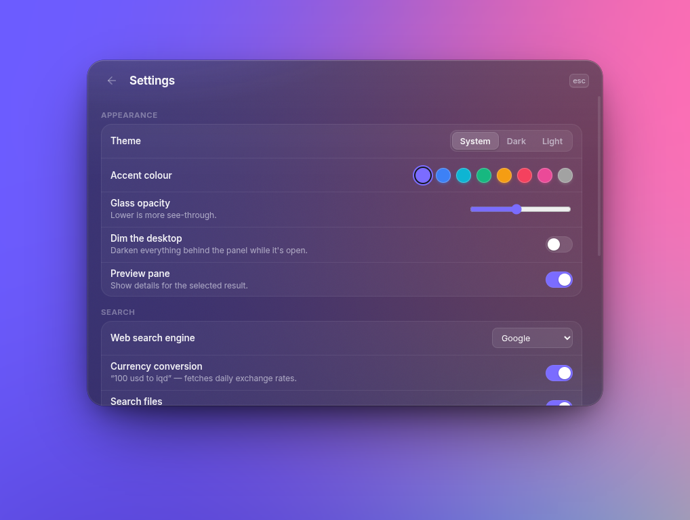
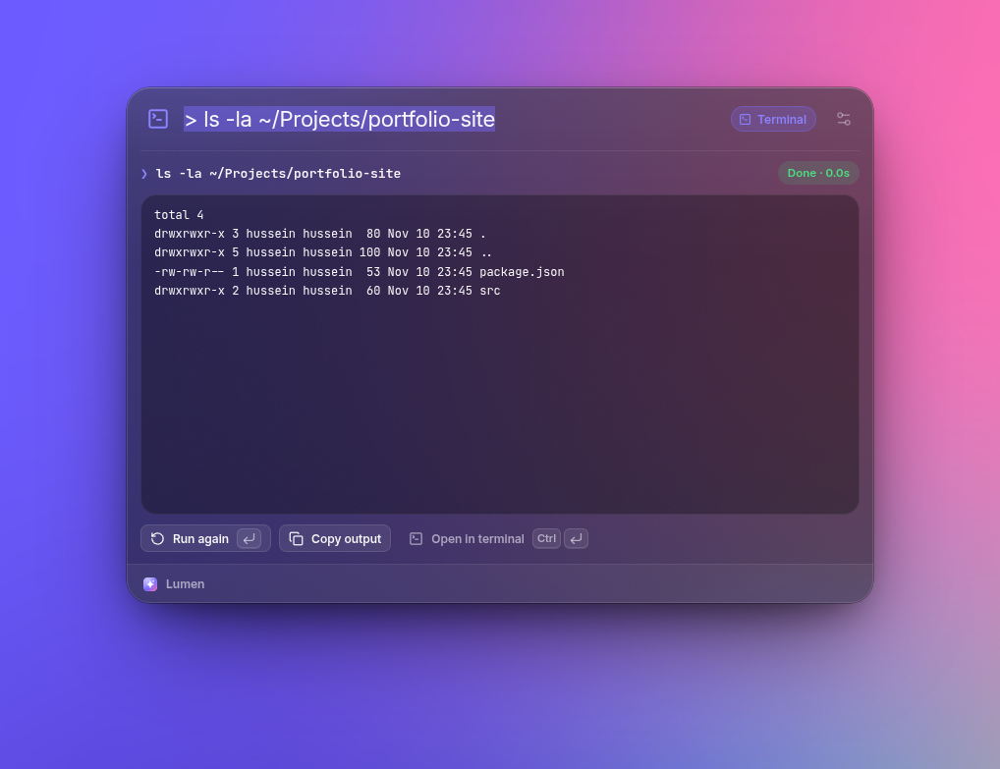
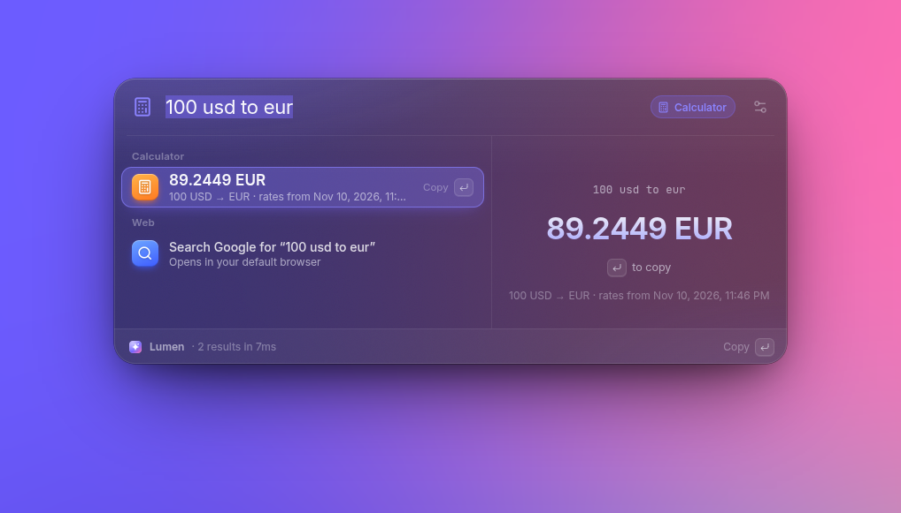
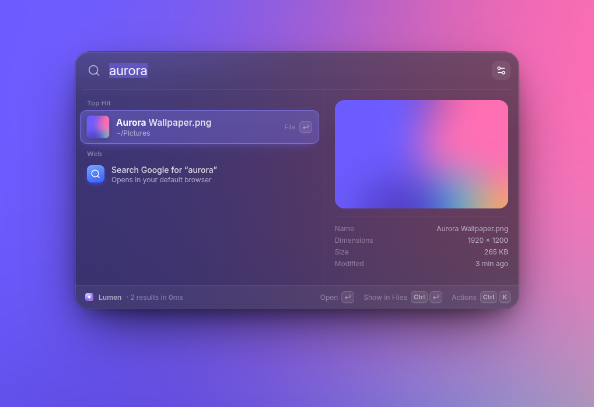
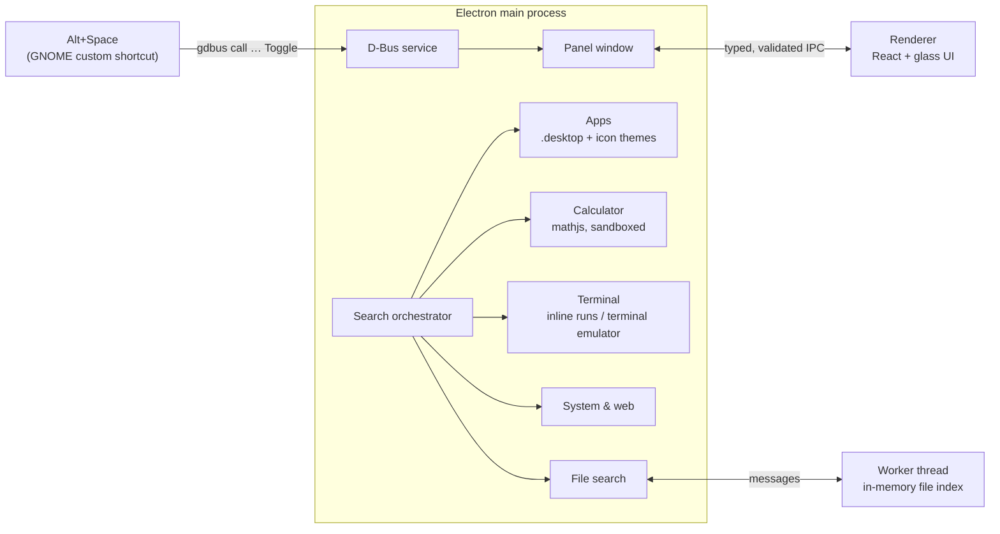

<div align="center">


# Lumen

**A fast, glassy, Spotlight-style launcher for Linux.**
Press <kbd>Alt</kbd> + <kbd>Space</kbd> to find apps, files and folders, run terminal commands, do math and conversions, and open or search the web, all from one panel.

[](https://github.com/YOUR_USERNAME/lumen/actions/workflows/release.yml)
[](https://github.com/YOUR_USERNAME/lumen/releases/latest)


[](LICENSE)



</div>

## Features

- **Apps.** Every installed app (system, Flatpak, Snap, `~/.local`), with the icons from your icon theme and each app's quick actions like *New Incognito Window*.
- **Files and folders.** An in-memory index on a background thread answers in a few milliseconds, with fuzzy matching (`projprop` or `ppd` → *Project Proposal.docx*), recently used files ranked higher, and live previews of images, text, code and folders.
- **Path browsing.** Type `~/` or `/` to walk the filesystem directly.
- **Terminal.** `> htop` opens in your terminal; `> ls -la` runs right in the panel and streams the output. Ctrl+Enter sends any command to a real terminal.
- **Calculator.** `2^10`, `sqrt(2) * pi`, `15% of 80`, unit conversion (`5 km to mi`, `30 c to f`, `5 GB to MB`) and currency (`100 usd to iqd`).
- **Web.** URLs open directly in your default browser (Brave, Firefox, Chrome…). Anything else can be searched, with shortcuts like `yt`, `gh`, `wiki`, `maps`, `npm`, `so` and `tr`.
- **System.** Lock, sleep, log out, restart, shut down, dark/light mode, Wi-Fi, Do Not Disturb, empty Trash. Destructive actions ask for a second Enter.
- **Learns from you.** Frecency ranking puts what you open most at the top, and the start screen shows your favourite apps and recent files.
- **Feels native.** Glass design with a light/dark theme, accent colours, smooth spring animations, a sliding selection, full keyboard control and an actions menu (Ctrl+K).
- **Instant toggle.** The shortcut talks to the running app over D-Bus, so the panel appears in about 5 ms.

## Screenshots

| | |
|:-:|:-:|
|  |  |
| **Start screen:** favourite apps, recent files, tips | **Files:** fuzzy search with live preview |
|  |  |
| **Terminal:** run commands and see the output | **Calculator:** math, units and currency |
|  |  |
| **Image previews** | **Settings:** theme, accent, glass, search engine |

## Install

Download the latest **AppImage** or **.deb** from [Releases](https://github.com/YOUR_USERNAME/lumen/releases/latest).

**AppImage** (any distro, no root needed):

```bash
chmod +x Lumen-*.AppImage
./Lumen-*.AppImage
```

On first launch Lumen adds itself to your app menu and to *Startup Applications*, then offers to set up <kbd>Alt</kbd>+<kbd>Space</kbd>. Keep the AppImage somewhere permanent, like `~/Applications`, before you run it.

**Debian / Ubuntu:**

```bash
sudo apt install ./lumen_*_amd64.deb
```

Then open **Lumen** from your app menu.

### The shortcut

On **GNOME** (Ubuntu, Fedora, …) Lumen sets up <kbd>Alt</kbd>+<kbd>Space</kbd> for you with one click. It adds a custom shortcut, the same thing *Settings → Keyboard → Custom Shortcuts* does, and moves GNOME's own Alt+Space window menu out of the way. Undo it anytime in Settings, or from a terminal:

```bash
lumen --setup-shortcut     # or: ./Lumen.AppImage --setup-shortcut
lumen --remove-shortcut    # restores GNOME's original Alt+Space
```

On **other desktops** (KDE Plasma, Cinnamon, Xfce, Hyprland, Sway…), Lumen tries a regular global shortcut first. If your desktop doesn't allow that, bind <kbd>Alt</kbd>+<kbd>Space</kbd> to `lumen --toggle` in its keyboard settings. The welcome screen shows the exact command.

## Using Lumen

| Keys | What it does |
| --- | --- |
| <kbd>Alt</kbd>+<kbd>Space</kbd> | Open or close Lumen |
| <kbd>↑</kbd> <kbd>↓</kbd> · <kbd>Ctrl</kbd>+<kbd>N</kbd>/<kbd>P</kbd> | Move through results |
| <kbd>Enter</kbd> | Open, run or copy the selected result |
| <kbd>Ctrl</kbd>+<kbd>Enter</kbd> | Show a file in Files · run a command in the terminal |
| <kbd>Ctrl</kbd>+<kbd>K</kbd> or <kbd>Tab</kbd> | More actions (copy path, open terminal here, app actions…) |
| <kbd>Ctrl</kbd>+<kbd>,</kbd> | Settings |
| <kbd>Esc</kbd> | Clear the search, then close |
| Click outside | Close |

| Type | To |
| --- | --- |
| `> command` | Run a shell command (inline output, or in your terminal) |
| `= expression` | Force calculator mode |
| `? query` | Search the web |
| `~/` or `/` | Browse folders |
| `yt` `gh` `wiki` `maps` `npm` `so` `tr` `img` `reddit` `mdn` + text | Search that site |
| `github.com`, `localhost:3000`, `192.168.1.1` | Open in your browser |

## How it works



A few details worth knowing:

- **Wayland first.** Wayland doesn't let apps place their own windows or grab global keys. Lumen opens a transparent window over the screen and draws the panel at Spotlight's position itself, so placement is the same on every compositor. A click on the transparent area, or focus moving elsewhere, closes it.
- **The shortcut is instant.** GNOME runs `gdbus call` straight into the running process instead of starting a second Electron instance, which takes about 5 ms instead of about 300 ms.
- **Security.** The renderer is sandboxed with context isolation and no Node access. Every IPC call is checked against the panel's own `webContents`, settings are validated against a schema, mathjs runs with `import`/`evaluate`/`createUnit` disabled, and icons go through a custom protocol that serves only files Lumen resolved itself.
- **Clean child processes.** Apps start fully detached through `gio launch` (so D-Bus activation and startup notification work). Lumen first removes the environment variables Electron and the AppImage runtime inject, so launched apps behave as if started from the desktop.
- **Packaging.** A small launcher script handles the fast `--toggle` path. The .deb ships an AppArmor profile so Chromium's sandbox works on Ubuntu 24.04+, and the AppImage uses the static runtime, so it doesn't need `libfuse2`.

## Development

Requirements: Node.js 22+ and a Linux desktop.

```bash
npm install
npm run dev          # hot-reloading dev build
npm run typecheck
npm run dist         # release/Lumen-x.y.z-x86_64.AppImage and release/lumen_x.y.z_amd64.deb
npm run icons        # re-render build/icons from resources/icon.svg
```

Environment switches for testing:

| Variable | Effect |
| --- | --- |
| `LUMEN_DEBUG=1` | Opens DevTools and keeps the panel open when it loses focus |
| `LUMEN_USER_DATA=/tmp/x` | Uses a separate settings/history folder |
| `LUMEN_X11=1` | Runs under XWayland instead of native Wayland |

Project layout:

```
src/
  main/            Electron main process
    providers/     apps, calculator, terminal, web, system
    files/         file index (worker thread) + previews
    search.ts      ranking and sections
    shortcut.ts    GNOME keybinding setup
    window.ts      panel window
  preload/         typed bridge exposed as window.lumen
  renderer/        React UI and glass design tokens
  shared/          types and constants shared by all three
build/             icons, launcher script, AppArmor profile, packaging hooks
```

Settings live in `~/.config/Lumen/settings.json`; usage history (for ranking) lives in `history.json` next to it.

## Releasing

Releases are built by GitHub Actions only when you **publish a GitHub release**, not on every push:

1. Push your changes to `main`.
2. On GitHub, go to **Releases → Draft a new release**, create a tag like `v0.2.0`, and publish it.
3. The [Release workflow](.github/workflows/release.yml) sets the app version from the tag, type-checks, builds, and attaches the `.AppImage`, the `.deb` and `SHA256SUMS.txt` to that release.

To rebuild an existing release, run the workflow by hand from the **Actions** tab and enter the tag.

## Known limitations

- GNOME doesn't give apps real background blur, so the glass is a frosted tint. Lower *Glass opacity* in Settings for a more see-through look.
- On Wayland, Lumen's window shows up in the dock and Alt+Tab while the panel is open.
- Automatic shortcut setup covers GNOME. Other desktops may need the one-time manual binding above.

## Roadmap

- GNOME Shell companion extension for real blur behind the panel
- Clipboard history and emoji picker
- Plugin API for custom providers
- Flatpak and AUR packages

## License

[MIT](LICENSE) © 2026 Hussein Shakir
